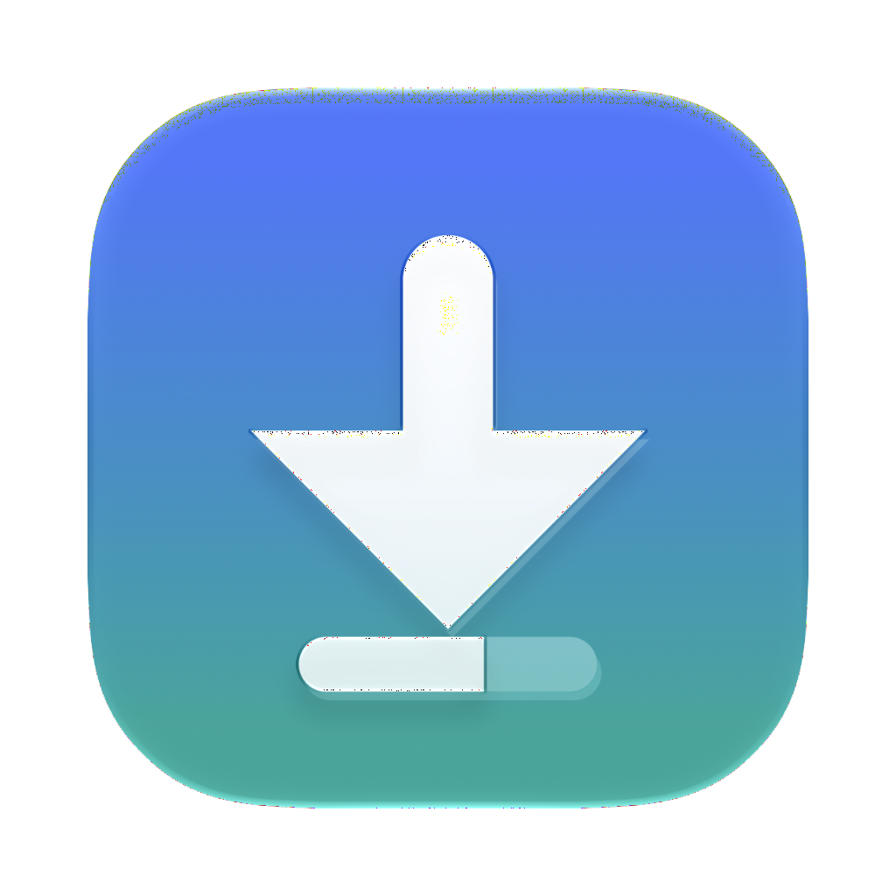
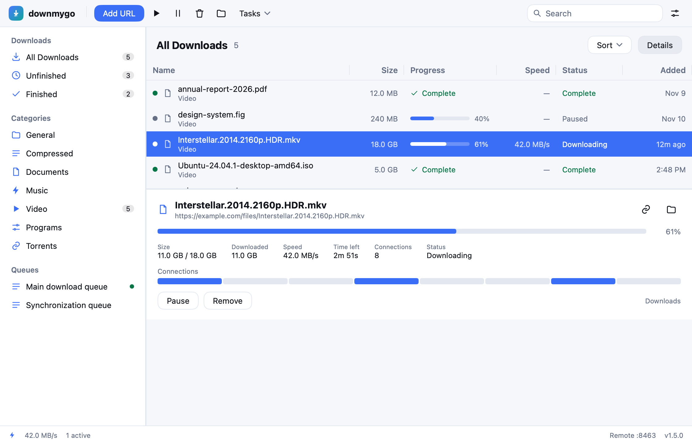
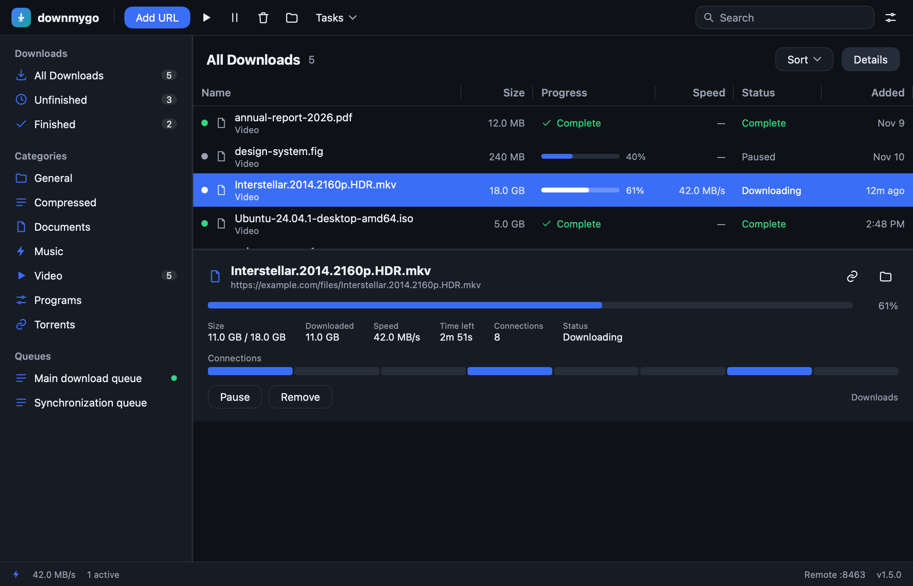

<p align="center">
  
</p>

<h1 align="center">downmygo</h1>
<p align="center"><b>Downloads, on the go.</b></p>

<p align="center">
  Windows · macOS · Linux &nbsp;|&nbsp; native UI, no webview &nbsp;|&nbsp; one binary &nbsp;|&nbsp; MIT
</p>

<p align="center">
  <a href="https://github.com/logdns/downmygo/actions/workflows/ci.yml"></a>
  <a href="https://github.com/logdns/downmygo/releases"></a>
  <a href="LICENSE"></a>
</p>

<p align="center">
  <a href="README.md">简体中文</a> · English · <a href="https://logdns.github.io/downmygo/">Website</a>
</p>

<p align="center">
  
</p>

---

## What it is

A cross-platform download manager written in **Go + [MyGo](https://github.com/egoist/mygo)**. The window is drawn natively on the GPU — no WebView — and the whole app is one binary.

Not a clone of IDM and not a fork: it keeps what a downloader needs and does it again with a quieter interface.

## Features

**Downloads** · 1–32 connections, the largest segment split in two · resume · single-stream fallback · SHA-256 · retries · proxy · speed and traffic limits

**Torrents** · a built-in BitTorrent client (DHT, trackers, peers) · magnets and `.torrent` files · pause and resume · seeding to a ratio or a time · upload limit

**Sites** · yt-dlp for videos and gallery-dl for galleries, **installed by the app when missing** · Chrome and Firefox extensions, and a userscript · site logins · capture rules · link grabbing · link import

**Feeds and unpacking** · RSS and Atom subscriptions · zip, 7z, rar, tar, gz, bz2 and xz unpacked after a download, refusing entries that leave the folder

**Network** · encrypted DNS (DoH and DoT) · a bind address for a VPN kill switch · debrid (Real-Debrid, AllDebrid)

**Automation** · a local API and a phone page · an MCP server · a command line · `downmygo://` and `magnet:` links

**Look** · three languages (English, 简体中文, 繁體中文) · light, dark or the system · theme files · an adaptive layout

**Updates** · check the latest GitHub release, verify its SHA-256, install it and reopen, silently when asked

<p align="center">
  
</p>

## Download

From [Releases](https://github.com/logdns/downmygo/releases):

| Platform | File |
|---|---|
| macOS | `downmygo-<version>.dmg` (universal, arm64 + x86_64) |
| Windows | `downmygo-setup-<version>-<arch>.exe`, or `downmygo-<version>-windows-<arch>.exe` |
| Linux | `downmygo_<version>_<arch>.deb`, or `downmygo-<version>-linux-<arch>.tar.gz` |

## Build

Go 1.27 or newer.

```sh
git clone https://github.com/logdns/downmygo
cd downmygo
go run .                 # development
go tool mygo build       # package into build/
go test ./...            # tests
```

## Command line

```sh
downmygo get URL -o DIR -c 8 --checksum sha256:<hex>
downmygo import links.txt      # add every link of a file
downmygo grab https://…        # print the links of a page
downmygo info                  # version, API port, tools
downmygo mcp                   # serve MCP on stdio
downmygo install-host <id>     # register the browser's host manifest
```

Progress goes to stderr, the final path to stdout. Exit codes: 0 success, 1 failure, 2 usage. The command line speaks English.

## Local API

```sh
TOKEN=$(python3 -c 'import json;print(json.load(open("'"$HOME"'/Library/Application Support/downmygo/state.json"))["settings"]["apiToken"])')
curl -H "Authorization: Bearer $TOKEN" http://127.0.0.1:8463/api/downloads
curl -X POST -H "Authorization: Bearer $TOKEN" -H "Content-Type: application/json" \
     -d '{"url":"https://example.com/a.zip"}' http://127.0.0.1:8463/api/add
```

Turn on Options → Advanced → “Let phones on the local network control downmygo”, then open `http://<computer-ip>:8463` on the phone.

## Documentation

The documents are in Chinese:

| Document | What it covers |
|---|---|
| [Architecture](docs/01-architecture.md) | layout, threads, engine, torrents, storage, UI, API, build |
| [Features](docs/02-features.md) | what each feature does, the logic, the limits |
| [Design](docs/03-design.md) | brand, colours, layout, adaptivity, languages |
| [MDM reference](docs/04-mdm.md) | the analysis of Mister Download Manager |
| [Extensions](extensions/README.md) | Chrome, Firefox and the userscript: install, store text, assets, packaging |

## License

MIT, see [LICENSE](LICENSE). downmygo is an independent implementation and contains no code, icon or text of another downloader.
