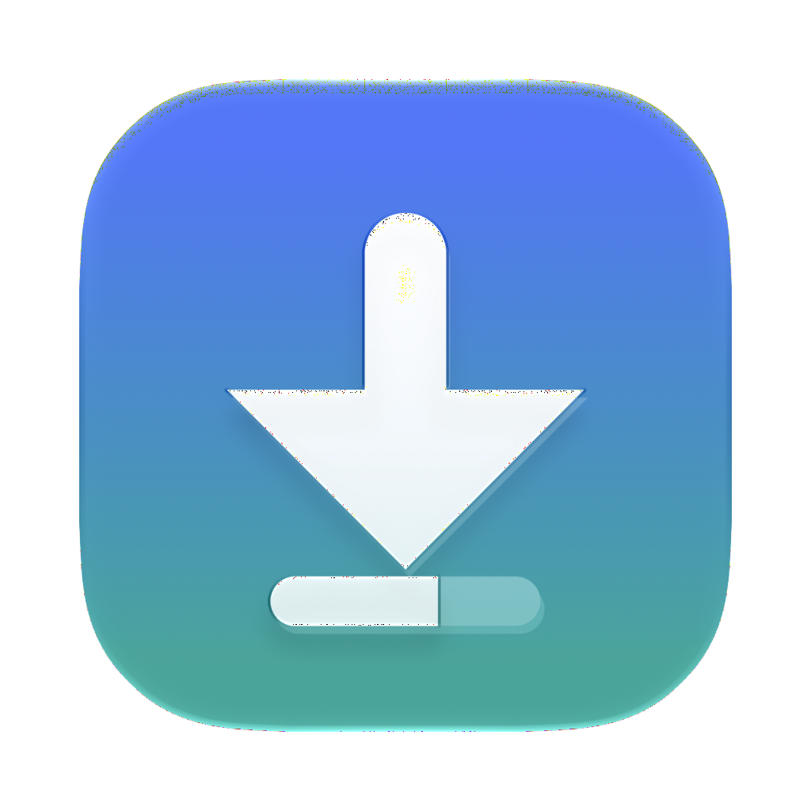
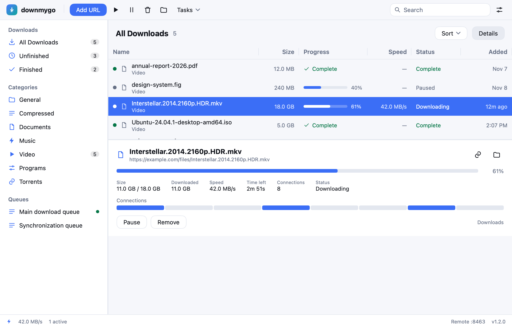
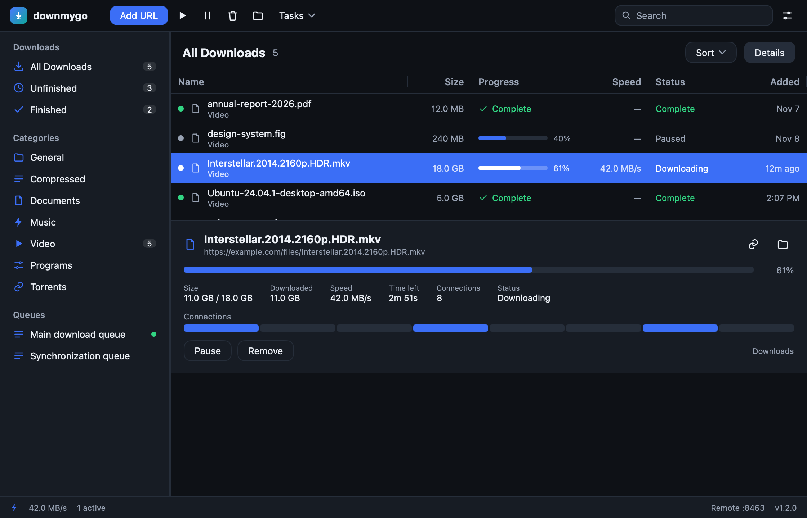
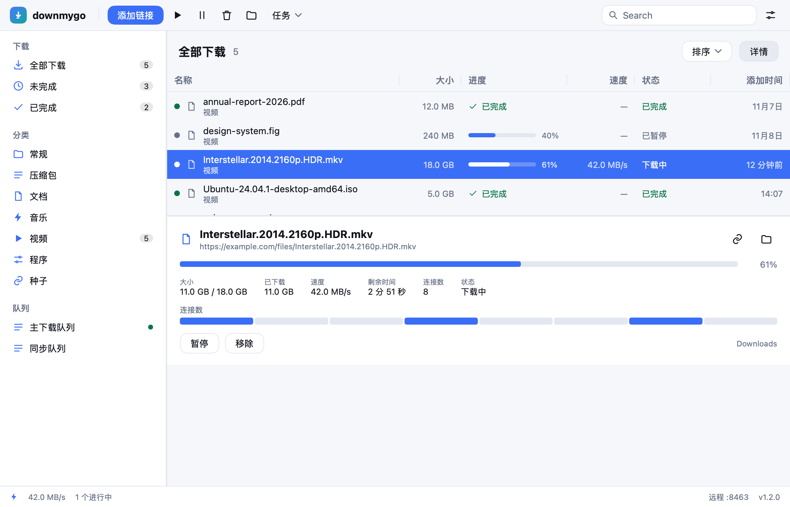

<p align="center">
  
</p>

<h1 align="center">downmygo</h1>
<p align="center"><b>Downloads, on the go.</b><br>下载，即刻启程。</p>

<p align="center">
  Windows · macOS · Linux &nbsp;|&nbsp; native UI, no webview &nbsp;|&nbsp; one binary &nbsp;|&nbsp; MIT
</p>

<p align="center">
  <a href="https://github.com/logdns/downmygo/actions/workflows/ci.yml"></a>
  <a href="https://github.com/logdns/downmygo/releases"></a>
  <a href="LICENSE"></a>
</p>

<p align="center">
  <a href="README.zh-CN.md">简体中文</a> · English
</p>

<p align="center">
  
</p>

---

## What it is

downmygo is a cross-platform download manager written in **Go + [MyGo](https://github.com/egoist/mygo)**. Its window is drawn natively on the GPU by MyGo's `ui` package — no WebView — and the whole app is one binary of a few megabytes.

It is not a clone of IDM and not a fork of MDM. It keeps what a downloader needs (connections, resume, list, queues, scheduling, browser hand-off) and does it again with a quieter, more modern interface.

The full feature list, the program's logic and what makes it different: **[docs/05-features.md](docs/05-features.md)** (Chinese).

## v1.0

- **Many connections** — 8 by default, 1–32; the largest remaining segment is split in two, so no connection sits idle.
- **Resume** — after a crash, a restart or a lost network; the segment table is written atomically, losing at most two seconds.
- **Probe** — size, file name, Range support, ETag / Last-Modified before the first byte.
- **Single stream fallback** — a server without Range gets one connection, and the window says so.
- **Checksums and file dates** — optional SHA-256; optional `Last-Modified` as the file's date.
- **The list** — name, size, progress, speed, status, time; sort, search, filter, context menu.
- **Categories** — General / Compressed / Documents / Music / Video / Programs / Torrents, editable.
- **Queues** — main, synchronization and your own; parallelism per queue; start and stop.
- **Scheduling** — start and stop times, a one-time date, start at login, and sleep, shut down, hibernate or quit when done.
- **Limits** — a token bucket per download and one for all of them; at most N MB every M hours.
- **Settings** — folder, connections, theme, accent, language, proxy, bind address, user agent, retries, notifications, tray, clipboard.
- **Three languages** — English, 简体中文, 繁體中文; follow the system or pick one, with dates and numbers in CLDR's way.
- **System integration** — tray (template icon), notifications, single instance, `downmygo://` deep links, window position memory.
- **CLI** — `downmygo get URL` with progress, checksum, Referer and cookies.
- **Local API** — `127.0.0.1:8463` behind a token: list, add, pause, resume, remove, queues.
- **Remote page** — open it from a phone on the same network and control the downloads.
- **Adaptive layout** — the sidebar folds into a filter menu, columns drop out and buttons become icons as the window narrows.
- **Browser** — an extension that sends links with their cookies, a native messaging host, site logins, capture rules and an importer.
- **Feeds and grabbing** — RSS/Atom subscriptions, link grabbing from a page, and a list importer.
- **External downloaders** — yt-dlp for videos and gallery-dl for galleries, installed by the app itself when they are missing, shown in the list with their progress.
- **Torrents** — a built-in BitTorrent client for magnets and `.torrent` files, with DHT and trackers, pause and resume.
- **Unpacking** — zip, tar, tar.gz and tar.bz2 after a download, refusing entries that leave the folder.
- **Network** — encrypted DNS (DoH and DoT), a bind address for a VPN kill switch, and debrid (Real-Debrid, AllDebrid).
- **Agents** — an MCP server on stdio with seven tools over the app's own API.
- **Themes** — JSON theme files over the built-in light and dark, with 19 color roles.
- **Updates** — a check of the latest GitHub release, with a link to it.
- **Look** — light, dark or follow the system, the brand's gradient, an empty state, a detail card and a status bar.

<p align="center">
  
</p>

<p align="center">
  
</p>

## Getting started

Download the app for your platform from [Releases](https://github.com/logdns/downmygo/releases):
`downmygo-<version>.dmg` for macOS (universal), `downmygo-setup-<version>-<arch>.exe`
for Windows, and a `.deb` or `.tar.gz` for Linux.

Or build it. Go 1.27 or newer.

```sh
git clone https://github.com/downmygo/downmygo
cd downmygo
go run .
```

Package it:

```sh
go tool mygo build      # reads mygo.json, writes build/
```

`mygo.json` already names the app, its identifier, version, icon, the `downmygo://` scheme and the catalogs' folder.

## Command line

```sh
downmygo get https://example.com/file.zip -o ~/Downloads -c 8
downmygo get https://example.com/file.zip --checksum sha256:<hex>
downmygo https://example.com/file.zip
```

- Progress goes to stderr, the final path to stdout.
- Exit codes: 0 success, 1 failure, 2 usage.
- The command line speaks English, for scripts and logs.

## Local API

```sh
TOKEN=$(python3 -c 'import json;print(json.load(open("'"$HOME"'/Library/Application Support/downmygo/state.json"))["settings"]["apiToken"])')

curl -H "Authorization: Bearer $TOKEN" http://127.0.0.1:8463/api/downloads
curl -X POST -H "Authorization: Bearer $TOKEN" -H "Content-Type: application/json" \
     -d '{"url":"https://example.com/a.zip"}' http://127.0.0.1:8463/api/add
```

`/api/add` also takes `name`, `dir`, `queue`, `start` (`false` adds without starting), `referer`, `cookies` and `duplicate`. A link that is already in the list answers 400 with the reason; send it again with `"duplicate":true` to add it anyway.

Turn on Options → Advanced → “Let phones on the local network control downmygo”, then open `http://<computer-ip>:8463` on the phone.

## Languages

The messages live in `locales/`: `en.json` (the source), `zh-Hans.json` and `zh-Hant.json`. After editing one, generate the accessors again:

```sh
go tool mygo generate   # writes locales/catalog_gen.go; commit it
```

## Icon

The icon's source is `resources/downmygo.icon`, an Icon Composer document. Redraw and export it:

```sh
go run ./tools/makeicon
```

It draws the layers, asks Icon Composer's own `ictool` for `resources/icon.png`, then fits it to the macOS icon grid. The tray icon and the mark in the window use the same geometry.

## Layout

```
main.go                 entry: CLI, window, menus, tray, single instance, deep links
internal/model          downloads, categories, queues, settings
internal/store          the data folder and its atomic JSON
internal/engine         probe, segments, workers, resume, checksums
internal/limiter        token buckets
internal/app            state machine, view, queues, scheduler, API
internal/ui             brand theme and icons
internal/cli            downmygo get, import, grab, mcp, native-host
internal/netset         encrypted DNS and the bind address
internal/nativehost     the browser bridge: framing, rules, logins
internal/rss            RSS and Atom
internal/tools          yt-dlp and gallery-dl
internal/extract        zip, tar and gzip
internal/grab           links from a page or a list
internal/debrid         Real-Debrid and AllDebrid
internal/themes         theme files
internal/mcp            the Model Context Protocol server
internal/update         the release check
browser                 the extension
locales                 the three catalogs and their generated accessors
resources               the icon (Icon Composer document and PNG)
cmd/preview             windowless screenshots
tools/makeicon          draws the icon and exports it
.github/workflows       CI and the three-platform release
```

More (Chinese):

- [Features, logic and what makes it different](docs/05-features.md)
- [The MDM analysis](docs/01-mdm-analysis.md)
- [Product definition and design system](docs/02-downmygo-product.md)
- [Architecture](docs/03-architecture.md)
- [Feature parity](docs/04-feature-parity.md)

## Development

```sh
go test ./...        # engine end to end, limiter, store, model, view, all three languages
go vet ./...
go run ./cmd/preview # writes docs/screens in English, 简体中文, 繁體中文 and narrow
go run ./tools/makeicon
```

## Releasing

- `ci.yml` — formatting, vet, tests with the race detector, a check that the generated catalog is current, then a build of each platform.
- `build.yml` — on a `v*` tag, builds macOS (universal + dmg), Windows (amd64/arm64 + NSIS installer) and Linux (amd64/arm64 + deb/tar.gz/PKGBUILD) and uploads them to a draft release.

## Roadmap

| Version | Theme |
|---|---|
| 1.0 | Core downloads, queues, scheduling, limits, CLI, API, remote page, three languages |
| 1.1 | Browser extension, site logins, capture rules, import, feeds, yt-dlp, gallery-dl, extraction, link grabbing, encrypted DNS, VPN binding, debrid, MCP, theme files, update check |
| 1.2 | Built-in BitTorrent, self-installing tools |
| 1.3 | rar and 7z, seeding and upload limits, silent updates |

## An independent implementation

downmygo is an independent implementation. It contains no code, icon, text or asset of Internet Download Manager, Mister Download Manager or any other downloader, is not affiliated with their authors, and offers no way to crack or bypass a paid service.

## License

MIT. See [LICENSE](LICENSE).
