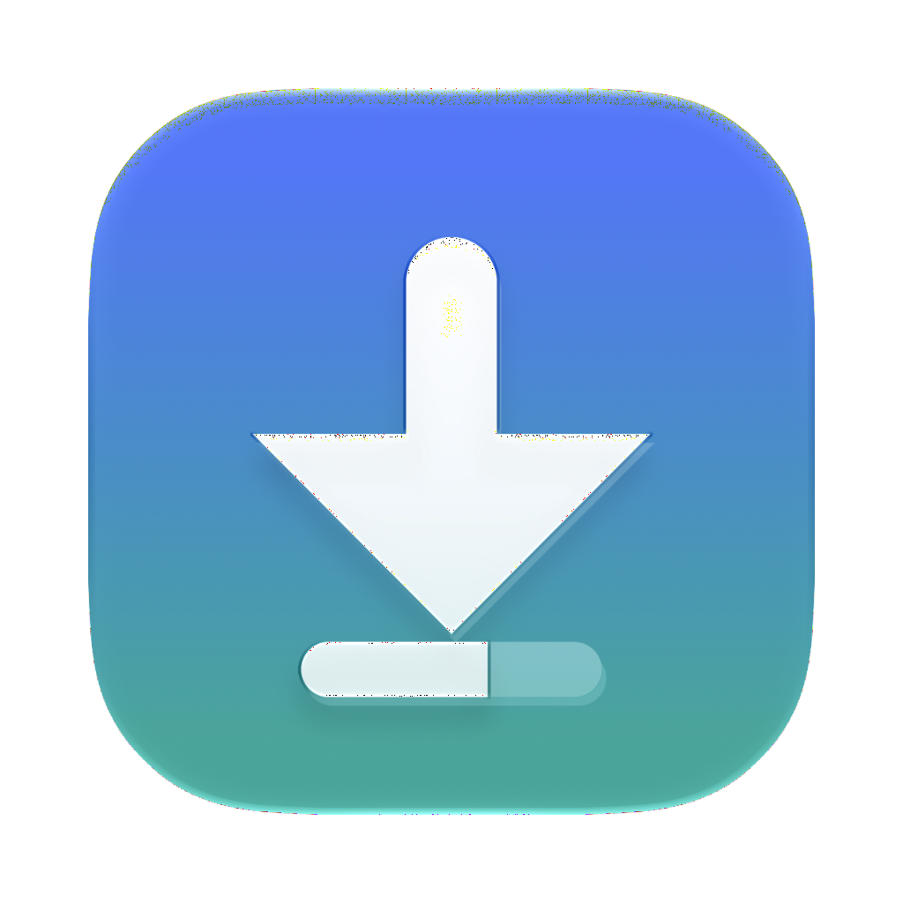
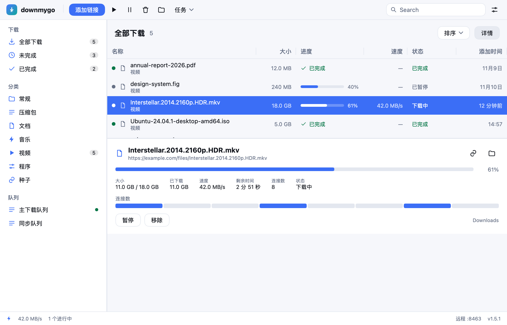
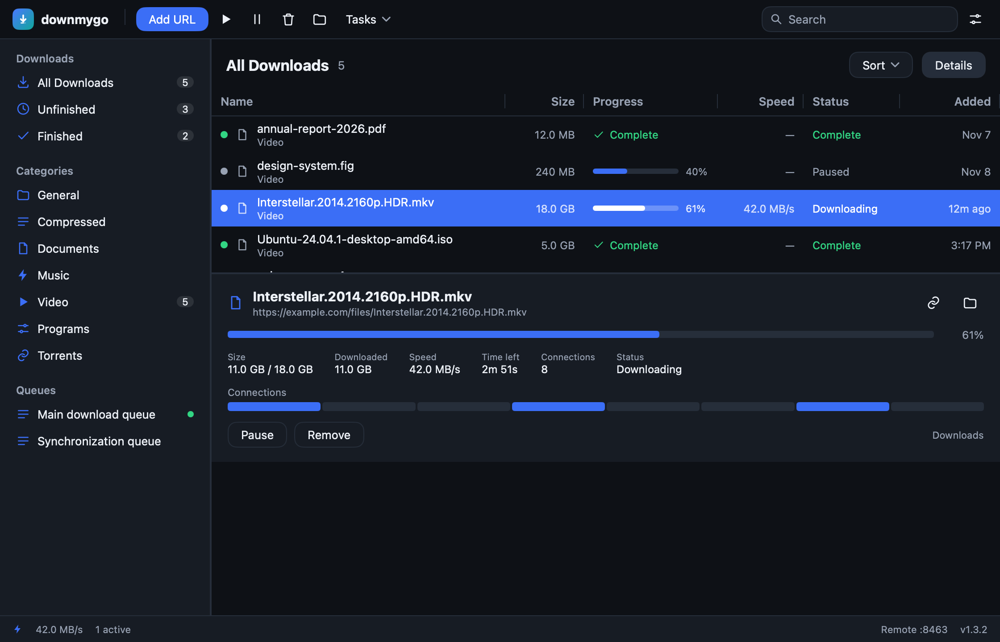

<p align="center">
  
</p>

<h1 align="center">downmygo</h1>
<p align="center"><b>下载，即刻启程。</b><br>Downloads, on the go.</p>

<p align="center">
  Windows · macOS · Linux &nbsp;|&nbsp; 原生界面，无 WebView &nbsp;|&nbsp; 单二进制 &nbsp;|&nbsp; MIT
</p>

<p align="center">
  <a href="https://github.com/logdns/downmygo/actions/workflows/ci.yml"></a>
  <a href="https://github.com/logdns/downmygo/releases"></a>
  <a href="LICENSE"></a>
</p>

<p align="center">
  简体中文 · <a href="README.md">English</a>
</p>

<p align="center">
  
</p>

---

## 它是什么

downmygo 是一个用 **Go + [MyGo](https://github.com/egoist/mygo)** 写的跨平台下载管理器。界面由 MyGo 的 `ui` 包在 GPU 上原生绘制，不启动 WebView；整个应用是一个十几 MB 的二进制。

它不是 IDM 的复刻，也不是任何现有下载器的 fork。它保留下载器最核心的工作流（多连接、续传、列表、队列、定时、浏览器接管），用更现代、更克制的界面重新做一遍。

完整的功能、逻辑与特点见 **[docs/05-features.md](docs/05-features.md)**。

## 已实现（v1.0）

- **多连接下载**：默认 8 条，可调 1–32；剩余最大的分段动态一分为二，连接不会早早闲着。
- **断点续传**：崩溃、重启、断网后继续；分段表原子保存，最多丢 2 秒。
- **服务器预检**：大小、文件名、是否支持 Range、ETag / Last-Modified。
- **单流回退**：服务器不支持 Range 时自动改为单连接，并在界面标注。
- **校验与文件时间**：可选 SHA-256；可选按服务器时间设置文件日期。
- **下载列表**：文件名、大小、进度、速度、状态、时间；排序、搜索、筛选、右键菜单。
- **分类**：常规 / 压缩包 / 文档 / 音乐 / 视频 / 程序 / 种子，可增删改。
- **队列**：主队列、同步队列、自建队列；每队列并行数；启动/停止。
- **调度**：启动/停止时间、一次性日期、开机启动、完成后睡眠/休眠/关机/退出。
- **限速**：单下载 + 全局令牌桶；每 N 小时 M MB 的流量上限。
- **设置**：目录、连接数、主题、强调色、语言、代理、网卡绑定地址、UA、重试、通知、托盘、剪贴板。
- **三种语言**：English、简体中文、繁體中文；跟随系统或手动切换，日期与数字按 CLDR 格式化。
- **系统集成**：托盘（模板图标）、通知、单实例、`downmygo://` 深链、窗口位置记忆。
- **CLI**：`downmygo get URL`，进度、校验和、Referer/Cookie。
- **本地 API**：`127.0.0.1:8463`，token 保护，列表/添加/暂停/继续/删除/队列。
- **远程页面**：手机浏览器打开即可添加、查看、暂停、继续、删除。
- **自适应布局**：窄窗口收起侧边栏、按宽度取舍列、按钮收成图标。
- **外观**：浅色/深色/跟随系统、品牌渐变、空状态、详情卡、状态栏。

<p align="center">
  
</p>

## 快速开始

直接下载：[Releases](https://github.com/logdns/downmygo/releases) 里有
macOS 的 `downmygo-<版本>.dmg`（universal）、Windows 的
`downmygo-setup-<版本>-<架构>.exe`，以及 Linux 的 `.deb` 与 `.tar.gz`。

或者自己构建，需要 Go 1.27+。

```sh
git clone https://github.com/downmygo/downmygo
cd downmygo
go run .
```

打包：

```sh
go tool mygo build      # 读取 mygo.json，产物在 build/
```

`mygo.json` 已配置名称、标识、版本、图标、`downmygo://` 深链与语言目录。

## 命令行

```sh
downmygo get https://example.com/file.zip -o ~/Downloads -c 8
downmygo get https://example.com/file.zip --checksum sha256:<hex>
downmygo https://example.com/file.zip
```

- 进度写 stderr，最终路径写 stdout。
- 退出码：0 成功，1 失败，2 用法错误。
- 命令行保持英文，便于脚本与日志检索。

## 本地 API

```sh
TOKEN=$(python3 -c 'import json;print(json.load(open("'"$HOME"'/Library/Application Support/downmygo/state.json"))["settings"]["apiToken"])')

curl -H "Authorization: Bearer $TOKEN" http://127.0.0.1:8463/api/downloads
curl -X POST -H "Authorization: Bearer $TOKEN" -H "Content-Type: application/json" \
     -d '{"url":"https://example.com/a.zip"}' http://127.0.0.1:8463/api/add
```

`/api/add` 还接受 `name`、`dir`、`queue`、`start`（`false` 只入队不开始）、`referer`、`cookies`，以及 `duplicate`。同一个链接已在列表里时，第一次调用返回 400 并说明原因；带上 `"duplicate":true` 再调一次即可加入。

打开设置 → 高级 → “允许局域网内的手机控制 downmygo” 后，手机访问 `http://<电脑IP>:8463` 即可使用远程页面。

## 语言

文案在 `locales/`：`en.json`（源语言）、`zh-Hans.json`、`zh-Hant.json`。改完文案重新生成访问器：

```sh
go tool mygo generate   # 写 locales/catalog_gen.go，要一起提交
```

## 图标

图标源文件是 `resources/downmygo.icon`（Icon Composer 文档）。重画并导出 PNG：

```sh
go run ./tools/makeicon
```

它画出图层、调用 Icon Composer 的 `ictool` 导出 `resources/icon.png`，再按 macOS 图标网格留边；托盘图标与窗口里的标记用同一套几何。

## 结构

```
main.go                 入口、窗口、菜单、托盘、单实例、深链
internal/model          下载/分类/队列/设置
internal/store          数据目录与原子 JSON
internal/engine         预检、分段、worker、续传、完成
internal/limiter        令牌桶
internal/app            状态机、视图、队列、调度、API
internal/ui             品牌主题与图标
internal/cli            downmygo get
locales                 三种语言的文案与生成的访问器
resources               图标（Icon Composer 文档与 PNG）
cmd/preview             无窗口渲染截图
tools/makeicon          画图标并导出
.github/workflows       CI 与三平台发布
```

更多：

- [功能、逻辑与特点](docs/05-features.md)
- [MDM 完整分析](docs/01-mdm-analysis.md)
- [产品定义与设计系统](docs/02-downmygo-product.md)
- [技术架构](docs/03-architecture.md)
- [功能对照](docs/04-feature-parity.md)

## 开发

```sh
go test ./...        # 引擎端到端、限速、存储、模型、视图、三种语言
go vet ./...
go run ./cmd/preview # 生成 docs/screens 的截图（英文、简中、繁中、窄窗口）
go run ./tools/makeicon
```

## 发布

- `ci.yml`：格式、vet、测试（含 race）、检查生成的 catalog 是否最新，然后三平台各构建一次。
- `build.yml`：打 `v*` 标签时构建 macOS（universal + dmg）、Windows（amd64/arm64 + NSIS 安装包）、Linux（amd64/arm64 + deb/tar.gz/PKGBUILD），上传到草稿 Release。

## 路线图

| 版本 | 主题 |
|---|---|
| 1.0 | 核心下载、队列、调度、限速、CLI、API、远程页面、三种语言 |
| 1.1 | 浏览器扩展、站点登录、捕获规则、导入 |
| 1.2 | 种子、视频、图库、解压、链接抓取 |
| 1.3 | 加密 DNS、VPN 绑定、debrid、MCP、主题文件、更新 |

## 独立实现声明

downmygo 是独立实现，不包含 Internet Download Manager、Mister Download Manager 或任何其他下载器的代码、图标、文案或资产。它不隶属于这些产品的作者，也不提供任何破解或绕过付费服务的能力。

## 许可

MIT。见 [LICENSE](LICENSE)。
