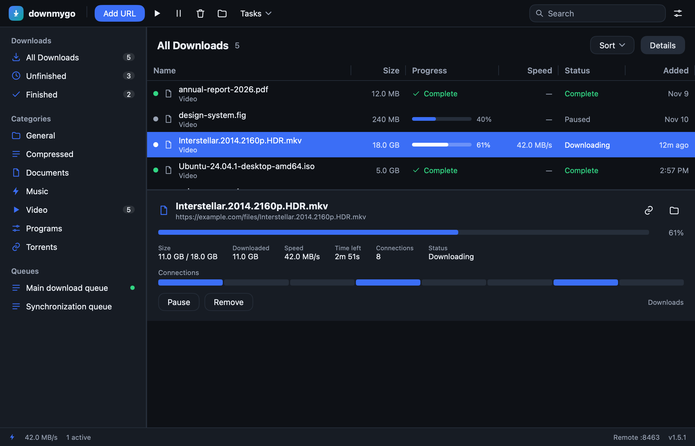
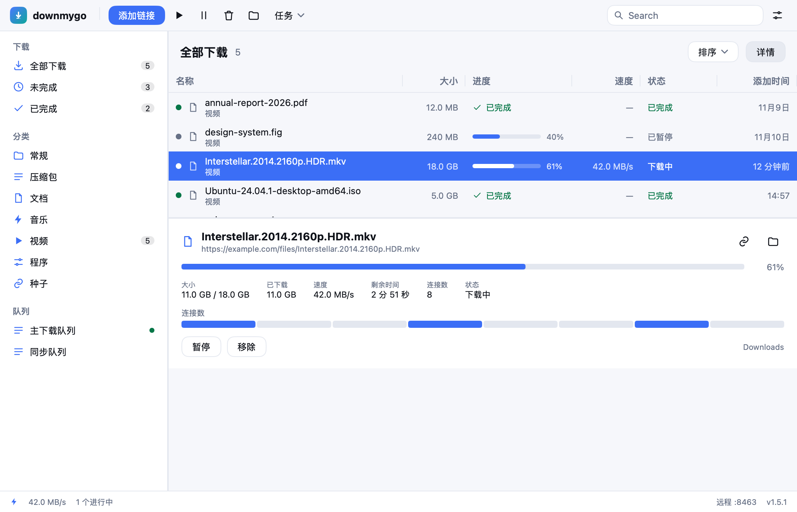
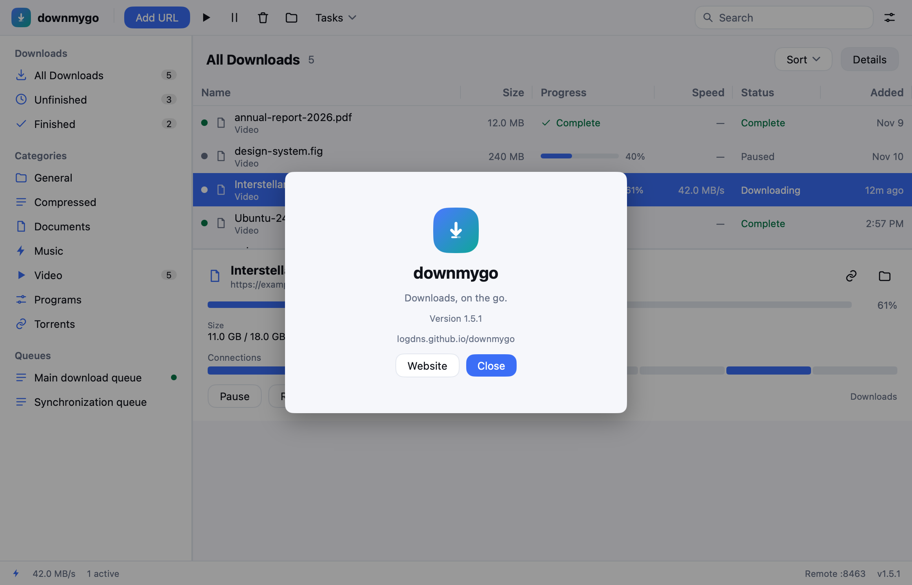

# downmygo 文档

| 文档 | 内容 |
|---|---|
| [01 · 架构](01-architecture.md) | 目录、线程、HTTP 引擎、种子、持久化、界面、API、外部程序、更新、构建 |
| [02 · 功能与状态](02-features.md) | 每项功能的状态与做法、程序逻辑、状态机、语言、明确不做的 |
| [03 · 设计](03-design.md) | 品牌与标志、颜色、字体间距、布局与自适应、组件、语言、动效 |
| [04 · 参考：MDM](04-mdm.md) | 立项时对 Mister Download Manager 的拆解与功能对照 |

英文：根目录的 [README.en.md](../README.en.md)。

插件（可单独上传到各商店）：[extensions/](../extensions/README.md) —— Chrome、Firefox、油猴脚本，各自的说明、打包脚本与商店素材。

## 截图

| 浅色 | 深色 |
|---|---|
|  |  |

| 简体中文 | 繁體中文 |
|---|---|
|  |  |

| 添加下载 | 设置 | 关于 |
|---|---|---|
|  |  |  |

| 窄窗口 |
|---|
|  |

截图由 `go run ./cmd/preview` 无窗口渲染生成，和真实窗口使用同一套视图代码。
