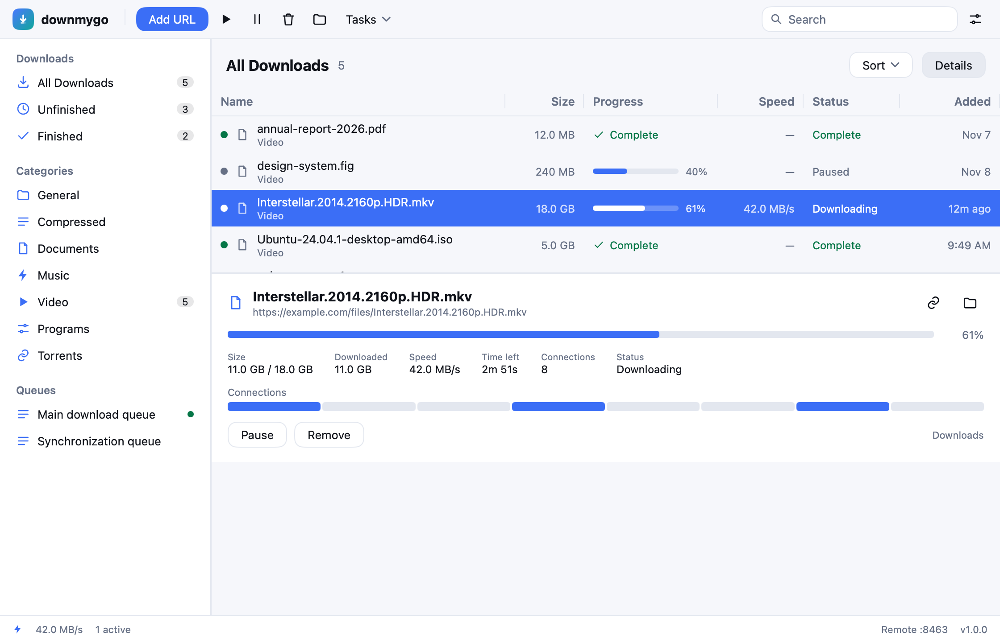
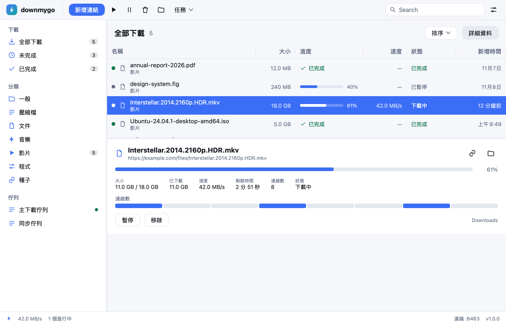
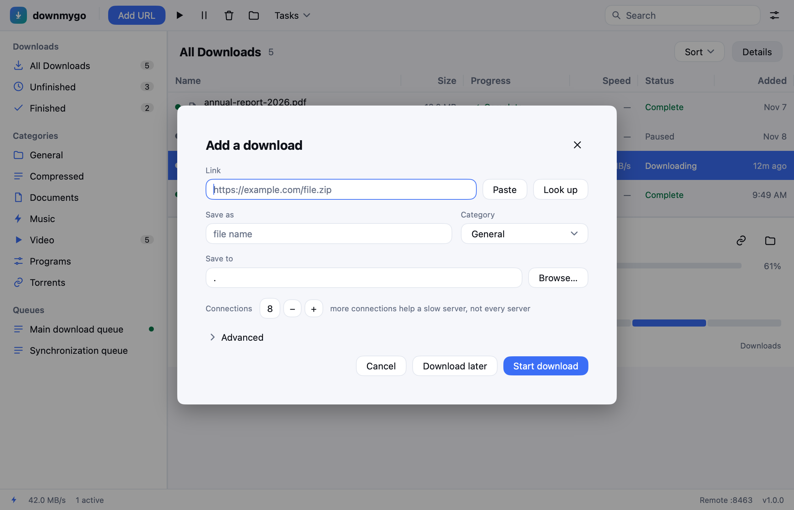
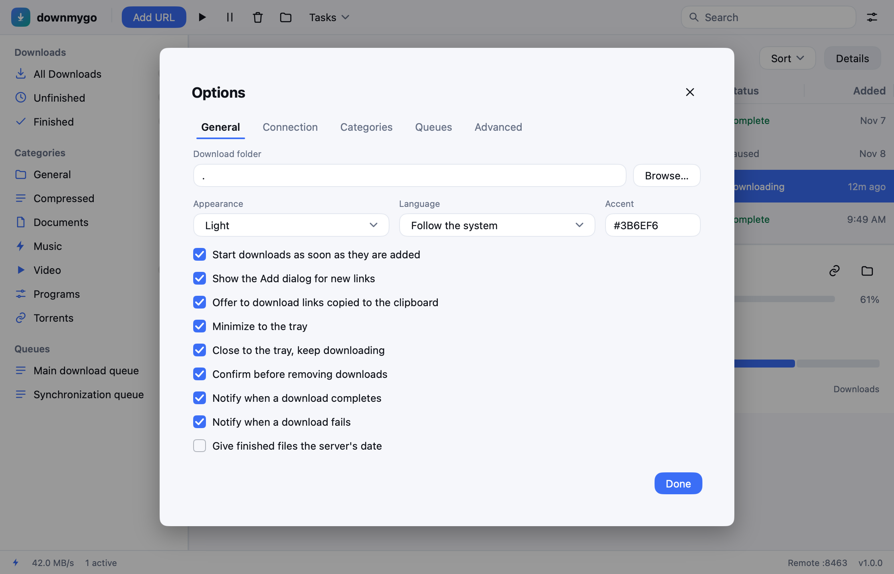
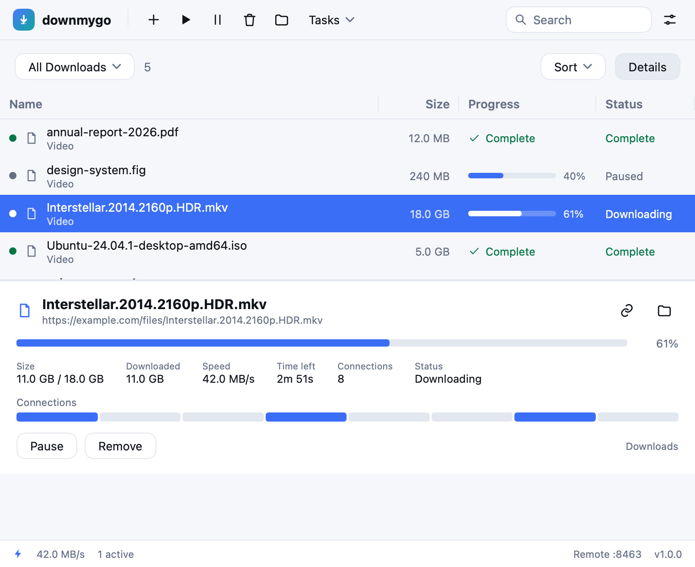

# downmygo 文档

| 文档 | 内容 |
|---|---|
| [01 · MDM 完整分析](01-mdm-analysis.md) | 对 Mister Download Manager 的架构、引擎、功能、UI、i18n、安全、测试与局限的完整拆解 |
| [02 · 产品定义](02-downmygo-product.md) | 品牌、定位、设计系统、功能范围、用户流程、非功能需求、路线图 |
| [03 · 技术架构](03-architecture.md) | Go/MyGo 架构、引擎算法、线程模型、持久化、UI、API、CLI、构建、扩展点 |
| [04 · 功能对照](04-feature-parity.md) | MDM 功能 → downmygo 状态（已实现/部分/计划/不做） |
| [05 · 功能、逻辑与特点](05-features.md) | 启动与下载流程、状态机、队列调度、限速、API、多语言、打包发布 |

## 截图

| 浅色 | 深色 |
|---|---|
|  |  |

| 简体中文 | 繁體中文 |
|---|---|
|  |  |

| 添加下载 | 设置 | 窄窗口 |
|---|---|---|
|  |  |  |

截图由 `go run ./cmd/preview` 无窗口渲染生成，和真实窗口使用同一套视图代码。
